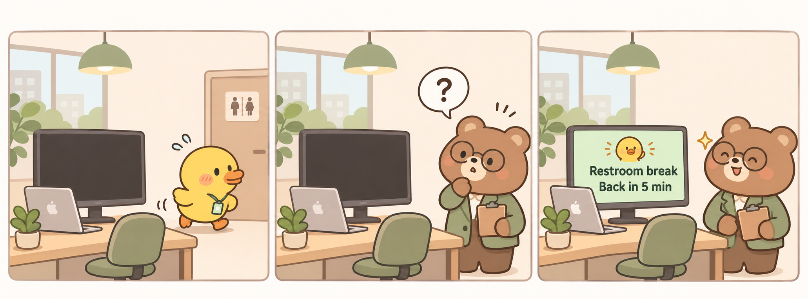
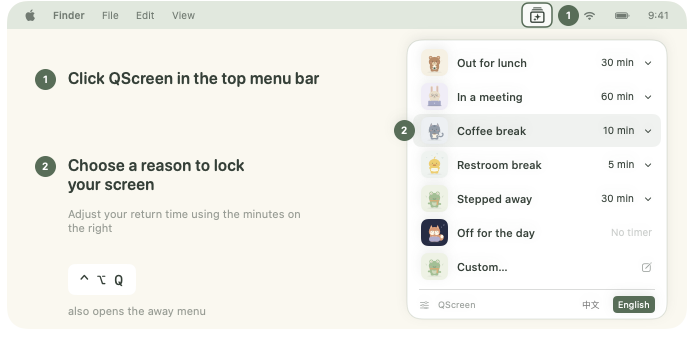
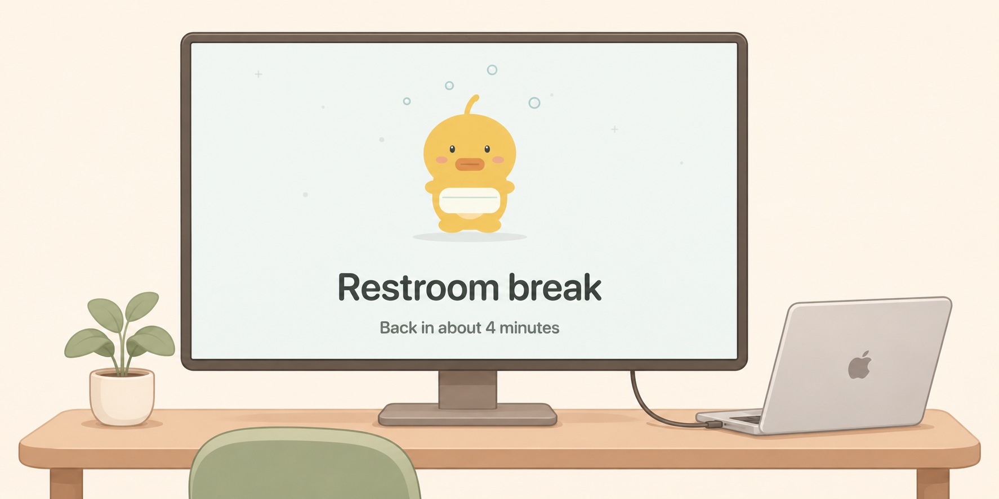

# QScreen

[Download the developer preview](https://github.com/DoggyDoggyKitten/QScreen/releases/tag/v0.5.3-preview.1) or [build from source](docs/DEVELOPMENT.md#build-and-install), then follow setup.

[MIT](LICENSE)
