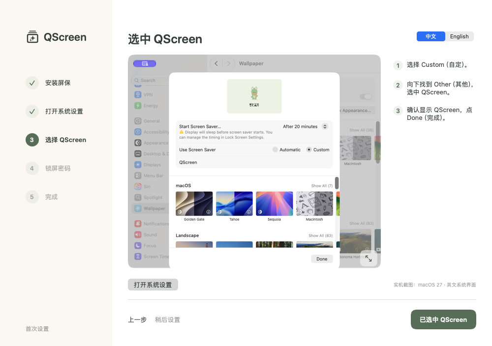

# QScreen

给 Mac 工位用的动态离席屏保。选择离席理由和时长，锁屏后用卡通角色和大字展示状态。


| 状态 | 角色 | 初始时长 |
| --- | --- | --- |
| 吃饭中 | 饭团熊 | 30 分钟 |
| 开会中 | 认真兔 | 60 分钟 |
| 喝杯咖啡 | 咖啡猫 | 10 分钟 |
| 去洗手间 | 泡泡鸭 | 5 分钟 |
| 暂时离开 | 漫游蛙 | 15 分钟 |
| 今天下班啦 | 晚安狐 | 无倒计时 |

## 开发与构建

需要 macOS 和 Xcode。无需第三方依赖。目标系统为 macOS 13 或更新版本，构建产物同时包含 Apple Silicon 和 Intel 架构。

```sh
bash scripts/build.sh
bash scripts/test.sh
open build/QScreen.app
```

输出为 `build/QScreen.app` 与 `build/QScreen.saver`。生成可分享的本地开发包：

```sh
bash scripts/package.sh
```

本地构建使用临时签名，没有 Developer ID 签名或公证。跨机器分发前需要正式签名、公证，并在目标 macOS 上测试。

## 安装

```sh
bash scripts/install.sh
```

安装到当前用户的 `~/Applications/QScreen.app` 和 `~/Library/Screen Savers/QScreen.saver`，不需要管理员密码。脚本会检查已有产物的 bundle ID，避免覆盖其他应用。

首次打开会自动进入独立的五步设置向导：

1. 安装屏保；已安装时会直接显示检查结果。
2. 打开系统「墙纸」，按实机截图找到顶部的「Screen Saver…／屏幕保护程序」。
3. 选择「Custom／自定」，在「Other／其他」中选中 QScreen，点 Done 后回到向导确认。这是用户确认，App 不会修改系统的屏保选择。
4. 在系统「锁屏」设置中，将启动屏保后要求输入密码设为「Immediately／立即」。向导会检测策略，未确认立即要求密码时不能完成。
5. 预览并开始使用。预览不锁屏；完成设置会再次检查安装、选择确认与密码策略。

向导附带 macOS 27 的真实系统设置截图，可点击右下角图标放大。截图为静态资源，使用向导不需要录屏或辅助功能权限。旧版系统的界面可能不同，向导提供 Apple 的对应帮助入口。

未完成就退出时，下次打开会恢复进度；「稍后设置」不会被标记为完成。已有用户升级后不会被强制重走，可在「设置 → 设置向导」重新打开。



一键离席直接启动系统原生屏保，由 macOS 的「立即要求密码」策略保护桌面。每次离席前，App 通过只读的 `sysadminctl -screenLock status` 检查该策略；延迟要求密码、读取失败或输出无法识别时，都会停止启动并提示设置。QScreen 不读取密码、不修改系统认证设置，也不需要辅助功能或键盘事件发送授权。

使用系统 `⌃⌘Q` 手动锁屏时，可能先显示系统锁屏背景。QScreen 的离席按钮会直接启动屏保，以立即展示角色和状态。

## 日常使用

- 点击菜单栏图标，或按 `⌃⌥Q`，打开快速离席菜单；按 Esc、再次点击图标或点击外部收起。
- 在快速菜单底部或设置页选择「中文 / English」。菜单、主窗口、设置、屏保理由和倒计时一起切换，重启后保留选择。切换语言不会重置离席理由或返回时间。
- 点击状态的角色或名称，使用该状态记住的时长开始离席并锁屏。
- 点击右侧分钟数可以先改时长；主窗口支持 1–480 分钟。
- 主窗口的「全屏预览」会在所有当前连接的显示器上预览，按键或点击退出。预览不锁屏，画面会明确标注。
- 选择「自定义 / Custom」，直接填写离席理由和返回分钟数（1–480），可从上方菜单选用已有角色。理由最多 40 个字符，长文字自动缩放换行；草稿会保留，自定义文字不会随中英文切换被翻译。快速菜单的「Custom…」也能进入编辑。
- App 通过系统进程间通知向原生屏保同步状态和返回时间，各显示器独立适配布局。无有效离席状态时显示「暂时离开」，不显示倒计时。
- 倒计时结束后显示「还没回来，稍等一下」。额外亮屏时长可设为 0、5、15 或 30 分钟，默认 5 分钟。
- 下班状态展示 5 分钟，普通无 ETA 的屏保展示 15 分钟，然后释放保持亮屏的请求，实际熄屏时间由系统决定。

解锁通知会清除离席状态；在 App 内恢复操作或退出 App 时也会清除。解锁通知属于兼容性信号，不是认证依据，在各 macOS 版本上需实测。12 小时前的状态会自动失效，避免长期显示过期信息。

## 验证范围

自动测试覆盖倒计时边界、超时、损坏数据、状态过期、睡眠后时间连续性、亮屏截止时间、跨进程状态读写、不同偏好域之间的实时状态同步和清除、中英文切换与持久化、英文分钟单复数、六种画面的双语渲染，以及原生 `.saver` 的加载和启停。`--smoke-test` 还会输出中英文 App、设置页和快速菜单截图，以及时长保存和语言切换结果到 `/tmp/qscreen-smoke/`，不会触发锁屏。

`--setup-smoke-test` 会在 `/tmp/qscreen-setup-smoke/` 生成中英文共十张向导截图，检查资源载入、进度恢复和完成条件，并恢复测试前的向导偏好。流程单元测试覆盖首次使用、未完成恢复、已有用户迁移、损坏的进度及缺失设置的组合。

绘制测试还会模拟系统无法创建圆角字体的情况，验证回退字体不会导致 App 或屏保崩溃。锁定策略测试验证延迟密码、未知状态、失败命令及矛盾输出都不能启动离席。启动诊断记录在 `~/Library/Logs/QScreen/`，仅包含本地运行状态；`open -g qscreen://diagnostics` 可刷新当前锁定策略和安装状态快照。

真实锁屏、系统屏保选择，以及开合盖和多个外接显示器，需要在目标机器上完成一次人工验收，详见 [验收步骤](docs/ACCEPTANCE.md)。本地构建成功和预览成功不代表这些场景已验证。

## 实现结构

- `App/`：SwiftUI 菜单栏应用、全局快捷键、首次设置和全屏预览。
- `ScreenSaver/`：Objective-C `ScreenSaverView` 原生屏保模块。
- `Shared/`：状态模型、本地偏好存储、进程间状态通知和 AppKit 矢量动画。
- 角色由 AppKit 路径、圆形和曲线直接绘制，眨眼、呼吸及道具动作由时间驱动；无需图片生成服务或位图素材。
- `Tests/`：状态、存储和渲染测试。
- `scripts/`：构建、测试、安装和打包。

屏保使用有截止时间的 IOKit 亮屏请求，不修改 `pmset` 或系统的锁屏、安全设置。它不阻止手动睡眠，也不能让已经睡眠的电脑持续渲染。MacBook 合盖展示依赖正常可用的外接屏合盖模式（通常需要供电、外接键鼠等条件）；拔掉显示器或合盖后进入系统睡眠时，画面会停止，唤醒后根据原返回时间恢复。


App 和系统屏保宿主的偏好文件可能被系统隔离。离席状态通过 `NSDistributedNotificationCenter` 的字符串消息同步，屏保启动时请求当前状态，并定期重试；不需要访问屏保宿主的容器或新增权限。消息仅用于展示，经过格式和时间范围校验，不参与锁定或认证判断。App 需要保持运行才能向新启动的屏保提供自定义状态。
